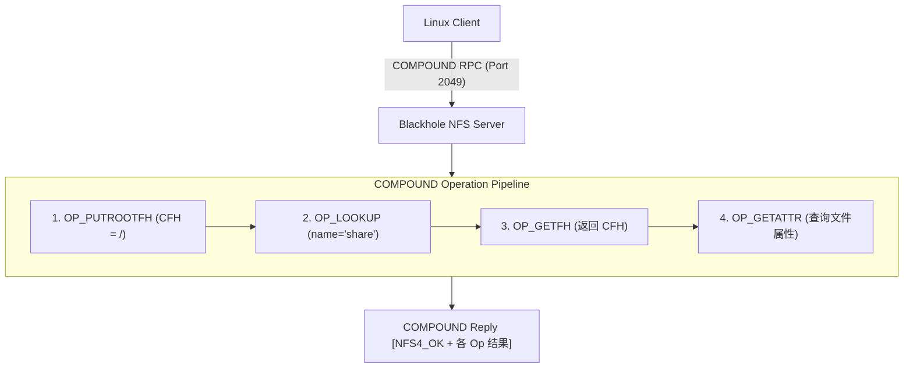

# RFC-0006: NFSv4+ 协议服务器轻量级原生支持 (NFSv4 Protocol Support)

- **Status:** Proposed (Under Review)
- **Author:** Antigravity Agent
- **Created Date:** 2026-10-31
- **Target Spec:** `specs/modules/nfsv4_support.spec.md`

## 1. Summary

在 Domour Drive (blackhole) 中实现原生、自包含、超轻量级的 **NFSv4.0/NFSv4.1 协议服务器**，直接监听标准 TCP `2049` 端口，无需外部依赖（无需 portmapper/rpcbind、无需 nfs-utils、无需 mountd/lockd），为 Linux 客户端及容器环境（Docker/Kubernetes）提供高性能、低 CPU 开销、完全遵循 POSIX 语义的文件共享与挂载服务。

## 2. Motivation

1. **针对 Linux 的极致性能**：
   - 相比 SMB3 在低功耗 RISC-V SoC（如 SpacemiT K1）上繁重的消息加密、签名与会话状态开销，NFS 报文紧凑、开销低，小文件并发 IOPS 及元数据查询（`stat`）速度优势明显。
2. **纯单端口现代化架构**：
   - NFSv3 需要复杂的 RPC 辅助进程（portmapper 111, mountd, statd, nlockmgr 等动态端口），防火墙与容器映射极其痛苦；
   - NFSv4+ 彻底简化为单一 TCP `2049` 端口通信，所有操作统一封装在 `COMPOUND` 复合过程调用中。
3. **原生 POSIX 与容器无缝集成**：
   - 支持完整的 Linux 权限位、软硬链接，适合作为 Docker 数据卷或 Linux 开发工作区直接挂载。

## 3. Protocol Architecture & Technical Design

### 3.1 传输层与 RPC 框架 (ONC RPC / XDR over TCP)
- **TCP 单端口**：仅监听 `:2049`（可配置 `BLACKHOLE_NFS_PORT`）。
- **Record Marking (RFC 5531 Section 11)**：
  - 4 字节前缀：`[LastFragment:1bit | FragmentLength:31bit]`。
- **ONC RPC v2 (RFC 5531)**：
  - `prog`: `100003` (NFS)
  - `vers`: `4` (NFSv4)
  - `proc`: `0` (NULL), `1` (COMPOUND)
  - `cred`: 支持 `AUTH_NONE` (0) 与 `AUTH_SYS / AUTH_UNIX` (1)
- **XDR 编解码器 (RFC 4506)**：
  - 4 字节对其的大端序（Big-Endian）序列化/反序列化。

### 3.2 复合操作机制 (NFSv4 COMPOUND)
NFSv4 所有核心业务请求均通过 `PROC_COMPOUND` 批处理执行，服务端维护单次 RPC 请求内的**当前文件句柄 (CFH, Current Filehandle)** 和 **保存文件句柄 (SFH, Saved Filehandle)** 状态机：

### 3.3 核心操作集 (Minimal Viable Operations for Linux Mount)
为满足标准 Linux 客户端（`mount -t nfs -o vers=4 <IP>:/ /mnt`）完整工作流，必须实现以下核心操作：

1. **会话与客户端注册 (Session & Client Registration)**：
   - `OP_SETCLIENTID` (Op 35) & `OP_SETCLIENTID_CONFIRM` (Op 36)：客户端标识协商与防重放租约确立；
   - `OP_RENEW` (Op 30)：租约续期保活。
2. **文件句柄与导航 (Filehandle & Navigation)**：
   - `OP_PUTROOTFH` (Op 24)：将 CFH 置为根导出目录句柄；
   - `OP_PUTFH` (Op 22)：恢复指定的文件句柄至 CFH；
   - `OP_SAVEFH` (Op 32) & `OP_RESTOREFH` (Op 31)：暂存与恢复 CFH；
   - `OP_GETFH` (Op 10)：获取当前 CFH；
   - `OP_LOOKUP` (Op 15)：根据目录名解析子项并将 CFH 切换为子节点。
3. **元数据与属性 (Attributes & Directory Listing)**：
   - `OP_GETATTR` (Op 9)：返回 `FATTR4_SUPPORTED_ATTRS`, `FATTR4_TYPE`, `FATTR4_FH_EXPIRE_TYPE`, `FATTR4_CHANGE`, `FATTR4_SIZE`, `FATTR4_FSID`, `FATTR4_FILEID`, `FATTR4_MODE`, `FATTR4_OWNER`, `FATTR4_OWNER_GROUP`, `FATTR4_LEASE_TIME` 等；
   - `OP_ACCESS` (Op 3)：检查 `READ`, `LOOKUP`, `MODIFY`, `EXTEND`, `DELETE`, `EXECUTE` 访问权限位；
   - `OP_READDIR` (Op 26)：流式枚举目录条目，返回文件名称、文件句柄及指定属性。
4. **文件数据读写 (File I/O)**：
   - `OP_OPEN` (Op 18) & `OP_OPEN_CONFIRM` (Op 20) & `OP_CLOSE` (Op 4)：状态化文件打开与关闭；
   - `OP_READ` (Op 25)：根据 offset 与 count 随机分片读取；
   - `OP_WRITE` (Op 38)：根据 offset 写入并返回写确认（UNSTABLE4 / FILE_SYNC4）。
5. **安全与协议协商 (Negotiation)**：
   - `OP_SECINFO` (Op 33)：返回支持的安全类型（默认返回 `AUTH_SYS` / `AUTH_NONE`）。

### 3.4 文件句柄 (Filehandle) 编码规范
定义结构紧凑、防篡改的 32 字节不透明句柄（`nfs_fh4`）：
- `Version` (uint8): 0x01
- `FsID` (uint8): 0x01
- `Ino` (uint64): 物理文件的 inode 编号
- `PathHash` (uint64): 相对根目录路径的 FNV-1a 哈希
- `Salt/Check` (uint64): 随机校验盐，防止非法句柄遍历
- `Padding` (6 字节)

3.5 客户端 IP 白名单访问控制 (IP Whitelist Security)
- 环境变量 `BLACKHOLE_NFS_ALLOWED_IPS`：支持逗号分隔的单一 IP（如 `192.168.50.240`）或 CIDR 网段（如 `192.168.50.0/24`）。
- 若配置了白名单，TCP Accept 连接后立即提取客户端源 IP 进行匹配校验，非授权 IP 连接立即关闭（Fail-closed），防止局域网未授权设备窥探或挂载。
- 若未配置该环境变量，则默认保持全开放模式。

## 4. Acceptance Criteria & Test Scenarios

1. **[SPEC-NFS-001] RPC & COMPOUND 协议解析**：正确解码 RPC Call 头部并分发各子操作，支持 NULL 探测及 COMPOUND 批处理。
2. **[SPEC-NFS-002] 客户端租约初始化**：成功响应 `OP_SETCLIENTID` 与 `OP_SETCLIENTID_CONFIRM`。
3. **[SPEC-NFS-003] 根目录探测与属性检索**：执行 `PUTROOTFH` + `GETATTR` 能正确返回根文件系统的 FSID、LeaseTime、容量与权限。
4. **[SPEC-NFS-004] Linux 原生挂载支持**：执行 `sudo mount -t nfs -o vers=4.0 <IP>:/ /mnt` 挂载成功且无内核报障。
5. **[SPEC-NFS-005] 目录列出与文件读写**：挂载后执行 `ls -la /mnt`、`cat /mnt/file`、`echo "hello" > /mnt/test.txt` 正常读写且持久化落盘。
6. **[SPEC-NFS-006] IP 白名单严格拦截**：仅允许白名单客户端（如 `192.168.50.240`）建立连接，非白名单客户端立即拒绝断开。
7. **[SPEC-NFS-007] 目录与软链接创建**：支持 `OP_CREATE` (NF4DIR / NF4LNK) 及 `OP_READLINK`，使 Linux `mkdir` 与 `ln -s` 成功工作。
8. **[SPEC-NFS-008] 文件与目录重命名**：支持 `OP_RENAME`，结合 SAVED_FH 与 CURRENT_FH 支持 `mv` 操作。
9. **[SPEC-NFS-009] 显式刷盘确认**：支持 `OP_COMMIT`，响应客户端 `sync` / `fsync` 调用。
10. **[SPEC-NFS-010] 硬链接支持**：实现 `OP_LINK`，支持 Linux `ln` 命令创建共享相同 inode 的硬链接。
11. **[SPEC-NFS-011] 字节范围锁与冲突判定**：实现 `OP_LOCK` 与 `OP_LOCKT`，支持共享读锁与排他写锁，提供严格重叠区间冲突检测，完全支持 SQLite 及 flock 机制。
12. **[SPEC-NFS-012] 锁释放与所有者清理**：实现 `OP_LOCKU` 与 `OP_RELEASE_LOCKOWNER`，维护稳定 stateid 演进与内存状态回收。
