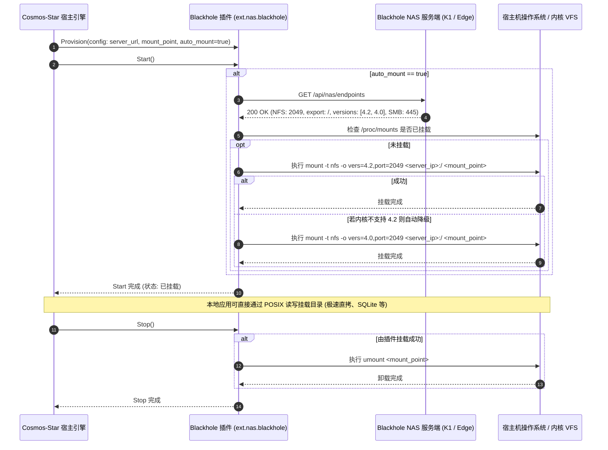

# RFC 0007: Cosmos-Star Blackhole 插件与自动挂载联动架构 (Auto-Mount Integration)

## 1. 概述与背景

Domour Drive (`blackhole`) 目前已实现完整的自包含高吞吐网络存储服务体系：
- 原生轻量级 **NFSv4.0 / NFSv4.1 / NFSv4.2** 服务（监听端口 `:2049`，支持 POSIX 锁与 Server-Side Copy 秒级直拷）；
- 原生 **SMB2/SMB3** 协议服务（监听端口 `:445`）；
- 兼容 HTTP / WebDAV 服务（监听端口 `:50056`）。

在集群协同系统 `cosmos-star` 中，外部插件 `ext.nas.blackhole` (`cmd/plugins/blackhole`) 原先仅封装了 HTTP REST API 操作（文件上传、安全文件夹加解密、离线下载任务等）。当集群应用需要以原生文件系统方式高频读写大文件、数据库（如 SQLite3）或共享资产时，频繁调用 HTTP 上传下载性能低下且破坏了 POSIX 语义。

**本方案目标：**
在 `cosmos-star` 的 `ext.nas.blackhole` 插件中支持 **全自动挂载 (Auto-Mount)**，联动 Blackhole 自动发现端点，并在插件启动 (`Start`) 时自动将 Blackhole 原生 NFSv4.2/4.0（或 SMB/WebDAV）共享无缝挂载到宿主机本地目录，插件停止 (`Stop`) 时自动卸载清理，同时保留完备的动态 Dispatch 挂载控制与状态查询 API。

---

## 2. 总体架构与交互流



---

## 3. 详细设计与协议规范

### 3.1 Blackhole 服务端支持 (`blackhole`)
在 Blackhole HTTP API 中提供端点能力发现：
- 新增 `GET /api/nas/endpoints`（并在 `GET /api/sysinfo` 中补充 `protocols` 字段）：
```json
{
  "server_version": "1.0.0",
  "share_dir": "/var/nas_share",
  "protocols": {
    "nfs": {
      "enabled": true,
      "port": 2049,
      "export_path": "/",
      "default_version": "4.2",
      "supported_versions": ["4.0", "4.1", "4.2"]
    },
    "smb": {
      "enabled": true,
      "port": 445,
      "share_name": "share"
    },
    "webdav": {
      "enabled": true,
      "port": 50056,
      "path": "/shared/"
    }
  }
}
```

### 3.2 Cosmos-Star 插件端实现 (`../cosmos-star/cmd/plugins/blackhole`)
1. **配置扩充 (`BlackholeClientConfig`)**:
   - `auto_mount`: bool，默认 `true`（只要提供了 `mount_point` 或允许自动挂载即生效）。
   - `mount_point`: string，挂载路径，默认 `/mnt/blackhole_nfs`（若无 root 权限或目录不存在可自动创建，不可写时可降级至当前用户 data 目录）。
   - `mount_proto`: string，默认 `"nfs"`，可选 `"smb"`、`"webdav"`。
   - `sudo_password`: string，可选 sudo 密码。
   - `sudo_pass_file`: string，可选密码文件（如 `~/.pass`）。

2. **自动检测与健康探活**:
   - 解析 `server_url` 提取目标主机 IP。
   - 检测挂载点健康度与 `/proc/mounts` 状态，防止重复挂载。

3. **动态 Dispatch 操作扩展**:
   - `mount`: `{"mount_point": "...", "proto": "nfs"}` 手动触发挂载。
   - `unmount`: `{"mount_point": "...", "lazy": true}` 手动触发卸载。
   - `get_mount_status`: 查询当前挂载状态、协议、挂载路径与容量。
   - `get_nas_endpoints`: 查询远程服务端提供的所有存储协议与端口。

---

## 4. 实施阶段计划

- **Phase 1 (Spec & Review):** 提交 RFC-0007 与规范 `specs/modules/cosmos_star_plugin_automount.spec.md`，等待审批。
- **Phase 2 (Blackhole Server Endpoints):** 在 `blackhole` 的 `internal/handler` 中实现 `GetNASEndpoints` API，更新单测。
- **Phase 3 (Cosmos-Star Plugin Auto-Mount):** 在 `../cosmos-star/cmd/plugins/blackhole/` 中实现自动挂载管理、sudo 提权执行与优雅卸载。
- **Phase 4 (Harness & Integration Testing):** 扩充 `../cosmos-star/pkg/ext/plugin/nas_plugin_test.go`，测试 `mount`, `unmount`, `get_mount_status` 流程。
- **Phase 5 (Deploy & Verify):** 部署至 K1 与本地客户端联调验证。
